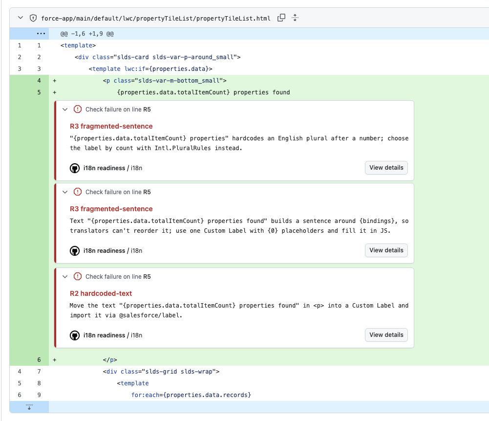
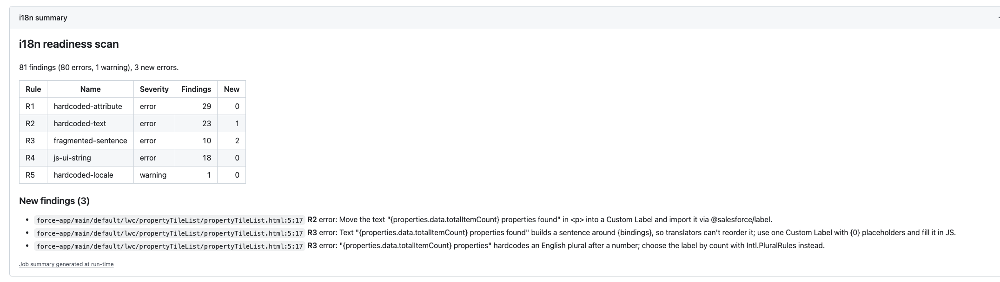
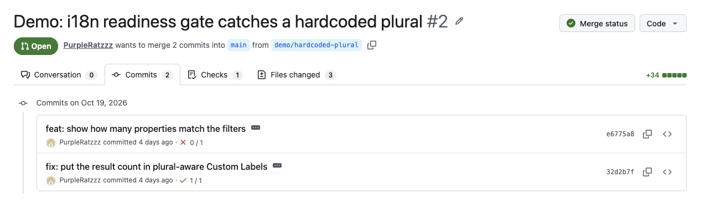

# lwc-i18n-readiness

Upstream i18n checks for Salesforce Lightning Web Components (LWC) and SFDX projects. The tool catches hardcoded and fragmented UI text before it reaches translation, and hands Custom Labels to a translator (human or AI) together with the context the translator needs.

> A personal portfolio project built on public Salesforce sample repos. It is not affiliated with Salesforce and has not been used in production.

## Why

Translation can only start once the source is ready. Text hardcoded in a component never reaches a translator and ships in English in every language. A sentence assembled from pieces can't be translated as a whole. A label with no description forces the translator to guess, and an AI translator guesses too.

Salesforce's localization team describes its AI translation pipeline as depending on structured context, and notes that content can only enter the pipeline once it is release-ready ([Salesforce Engineering: How AI rebuilt Salesforce's decades-old localization pipeline](https://engineering.salesforce.com/how-ai-rebuilt-salesforces-decades-old-localization-pipeline)). This project works on that upstream step.

In October 2026 I checked four LWC sample apps in [trailheadapps](https://github.com/trailheadapps) (lwc-recipes, ebikes-lwc, dreamhouse-lwc, coral-cloud). None of them uses a single Custom Label or has a translations folder. The official LWC ESLint plugin has no i18n rules and does not read HTML templates.

## What it does

| Part | What it does |
|---|---|
| **Scanner** (`lwc-i18n scan`) | Six rules over templates (parse5), JavaScript (@babel/parser) and Custom Labels. AST-based, not regex: a string is reported only when it reaches the user. |
| **PR gate** (`action.yml`) | Annotates findings on the PR diff and writes a full report to the job summary. Only findings that are not in the baseline fail the check, so a team can adopt it without fixing everything first. |
| **Pseudo-localization** (`lwc-i18n pseudo`) | Writes a `translation-meta.xml` with accented, bracketed, expanded text, using IBM's length-tiered expansion guideline. In the UI, plain English means hardcoded text and a missing `]` means truncation. |
| **XLIFF round trip** (`xliff-export` → `translate` → `xliff-import`) | Custom Labels → XLIFF 1.2: the description goes in `<note>`, `maxlen:` becomes `maxwidth`. A pluggable translator runs (stub, pseudo, or any command, e.g. an AI pipeline). Import validates placeholders, tags, length and state before writing `translations/<lang>.translation-meta.xml`. |
| **Engineer checklist** | [docs/i18n-checklist.md](docs/i18n-checklist.md): 12 rules, each with a real example from Salesforce sample code and the rule that catches it, or a note that it needs manual review. |

### Rules

| Rule | Catches | Real example |
|---|---|---|
| R1 hardcoded-attribute | `label="Reset"`, `alt=`, `title=`, `alternative-text=`… | dreamhouse `propertyFilter.html:5` |
| R2 hardcoded-text | Literal text in templates | dreamhouse `sampleDataImporter.html:8` |
| R3 fragmented-sentence | Text around `{bindings}`, sentences split by `<br>`/`<b>`, number + English plural | `{totalItemCount} items • page {currentPageNumber} of {totalPages}` |
| R4 js-ui-string | JS strings that reach the UI: toasts, modals, datatable labels, rendered fields, HTML built in JS, hardcoded `': '` and `.join(', ')` | ebikes `` `Order status set to "${value}"` `` |
| R5 hardcoded-locale | `currency-code="USD"`, literal locales in `Intl`. A warning: the currency must follow the amount's source | dreamhouse `propertyTile.html:14` |
| R6 label-context | Labels whose description just repeats the value, with no `ui:` category, unexplained `{0}`, or a sentence-fragment value | `LMR_Of` = "of" |

## See it on a real PR

[PurpleRatzzz/dreamhouse-lwc#2](https://github.com/PurpleRatzzz/dreamhouse-lwc/pull/2) runs this action in a fork of Salesforce's dreamhouse-lwc sample app. It was also the action's first run in a real repository: that run surfaced a Node 20 deprecation warning from `actions/setup-node@v4`, which v0.1.1 fixes.

- **`main`** has the workflow and a baseline that accepts the 78 findings the app has today, so its check is green.
- **Commit 1** adds `{properties.data.totalItemCount} properties found` to a template. The check fails, with three annotations on that line: hardcoded text (R2), a sentence built around a binding (R3), and an English plural (R3).
- **Commit 2** moves the text into two Custom Labels, one per plural form. Their descriptions say where the text appears and what `{0}` is, and a getter picks the form with `Intl.PluralRules`. The check passes, and the new labels file gets no R6 warnings.







The whole setup in the consumer repo:

```yaml
on:
    push:
        branches: [main]
    pull_request:
jobs:
    i18n:
        runs-on: ubuntu-latest
        steps:
            - uses: actions/checkout@v7
            - uses: PurpleRatzzz/lwc-i18n-readiness@v0.1.1
              with:
                  baseline: .i18n-baseline.json
```

## Results

### Scanner, measured on held-out code

The method, in short (details in [eval/README.md](eval/README.md)):

- The scanner was developed only against lwc-recipes and its own fixtures. dreamhouse-lwc and ebikes-lwc were kept out of development.
- The rules were frozen (tag `eval-freeze-1`) before the first run on those two repos.
- Each repo has a gold set of every user-visible hardcoded string. It was annotated by an independent AI agent that never saw the scanner, then reviewed row by row by me. Every disagreement between scanner and gold set was decided by hand.

| v1 (`eval-freeze-1`) | Precision | Recall |
|---|---|---|
| Hardcoded user-facing strings, dreamhouse-lwc | 59/59 | 59/63 |
| Hardcoded user-facing strings, ebikes-lwc | 66/66 | 66/70 |
| **Hardcoded strings, both repos** | **100% (125/125)** | **94.0% (125/133)** |
| **Fragmented sentences and plurals, both repos** | **100% (14/14)** | **80.0% (12/15)** |

Precision counts scanner findings; recall counts problems in the gold set. One problem can be hit by two findings (R3 reports `{n} items • page {p} of {t}` as both interpolated and plural), so the two counts can differ. Per-repo tables, with every human decision listed: [eval/results](eval/results).

Hardcoded currency codes (5 in total, all found) are reported to developers but not scored. The currency code has to follow where the amount comes from, so swapping it is not a translation fix.

The misses are at 9 source locations: 8 string units and 3 fragment units, 2 of which are the same location counted in both families. They fall into three kinds:

- text passed to native mobile features (barcode scanner instructions, a permission rationale);
- separators with no letters glued into messages or titles (`': ' + details`, `errors.join(', ')`, `` `${Address}, ${City}` ``);
- a sentence whose second half is nested inside `<b>` after a number.

The v2 rules (tag `eval-v2`) cover all three. Because v2 was written after seeing these repos, its results there are in-sample and are kept separately in [eval/results/v2](eval/results/v2). On the lwc-recipes dev set, v2 added 8 findings: 5 list joins in toasts and messages, and 3 sentences split by a link.

The sample is small: two apps, 133 hardcoded strings. These numbers show that the method works; they are not a benchmark.

### Custom Labels in the wild

On the real `CustomLabels.labels-meta.xml` of [salesforce/offline-app-developer-starter-kit](https://github.com/salesforce/offline-app-developer-starter-kit) (23 labels):

- **13 of 23** descriptions repeat the value word for word ("Cancel" / "Cancel"), so a translator gets no context.
- **7 of 23** values are sentence fragments meant to be glued together, such as `items`, `of` and `sorted by`. One description reads "X items of Y". Externalizing strings doesn't help if each label is only a piece of a sentence.

The full round trip on that file (export, pseudo translation, validated import, all 23 labels written) is in [examples/offline-starter-kit](examples/offline-starter-kit).

### Does the context help AI translation?

A preregistered, blind-judged experiment with project A (an AI translation pipeline), on real dreamhouse strings and on the starter-kit labels. [Details](examples/context-experiment/README.md).

- Context made **no difference for single strings**: 31 of 31 were acceptable without it.
- Every translation failure was in **sentences assembled from pieces**, or in a **hardcoded unit of measure (miles)**. Neither can be fixed by translation or caught by a per-string QA gate, which passed all of them.
- The upstream fix that matters is structure: whole sentences with placeholders, plus context that states layout constraints. Better descriptions alone are not enough.

## Quick start

Requires Node.js 22.

```bash
npm ci
npm run fetch-targets          # clone the scanned repos at their pinned commits into .targets/
node src/cli.js scan .targets/dreamhouse-lwc
```

```bash
# Accept today's findings, then fail only on new ones
node src/cli.js scan . --write-baseline .i18n-baseline.json
node src/cli.js scan . --baseline .i18n-baseline.json --format github
```

```bash
# Labels: pseudo-localize, export, translate, import
LABELS=path/to/force-app/main/default/labels/CustomLabels.labels-meta.xml
node src/cli.js pseudo "$LABELS" --locale eo --out out/
node src/cli.js xliff-export "$LABELS" --target-lang zh-CN --out out/labels.xlf
node src/cli.js translate out/labels.xlf --out out/labels.zh.xlf --lang zh-CN --translator pseudo
node src/cli.js xliff-import out/labels.zh.xlf --labels "$LABELS" --out out/translations
```

To plug in a real translator, set `LWC_I18N_TRANSLATOR_CMD` to any command that reads `{in}` and writes `{out}` (XLIFF 1.2), then run with `--translator command`.

### In CI

```yaml
- uses: actions/checkout@v7
- uses: PurpleRatzzz/lwc-i18n-readiness@v0.1.1
  with:
    baseline: .i18n-baseline.json
```

## Limitations

- **Static analysis only.** R4 follows strings into known UI sinks, module constants and one level of method parameters. It does not track local variables, return values or other modules.
- **Not every problem is a rule.** A picklist API value shown where its label belongs needs a human reviewer; the checklist covers it.
- **Not yet run in a Salesforce org.** The pseudo-localized file has not been deployed to an org; `eo` is a placeholder locale until a Developer Edition org confirms which languages can be enabled.
- **Small evaluation.** Two sample apps.

## How this was built

Built with [Claude Code](https://claude.com/claude-code) as an AI pair programmer. Claude Code helped with research, implementation and the first-pass gold annotation. The scope, the design decisions and every evaluation judgment (gold set review and adjudication) are mine, and the commit history records each step.

## Repository map

- [docs/ARCHITECTURE.md](docs/ARCHITECTURE.md): module contracts (Finding shape, rule interface, XLIFF and translator contract)
- [docs/i18n-checklist.md](docs/i18n-checklist.md): the engineer checklist
- [eval/](eval/): gold sets, adjudications, scoring script and results
- [examples/](examples/): round trip on a real labels file
- [targets.json](targets.json): every scanned repo, pinned to a commit

## License

MIT for the code. Example outputs derived from salesforce/offline-app-developer-starter-kit keep its BSD-3-Clause license (notice in that folder). The scanned repos are not vendored; they are fetched at pinned commits.
